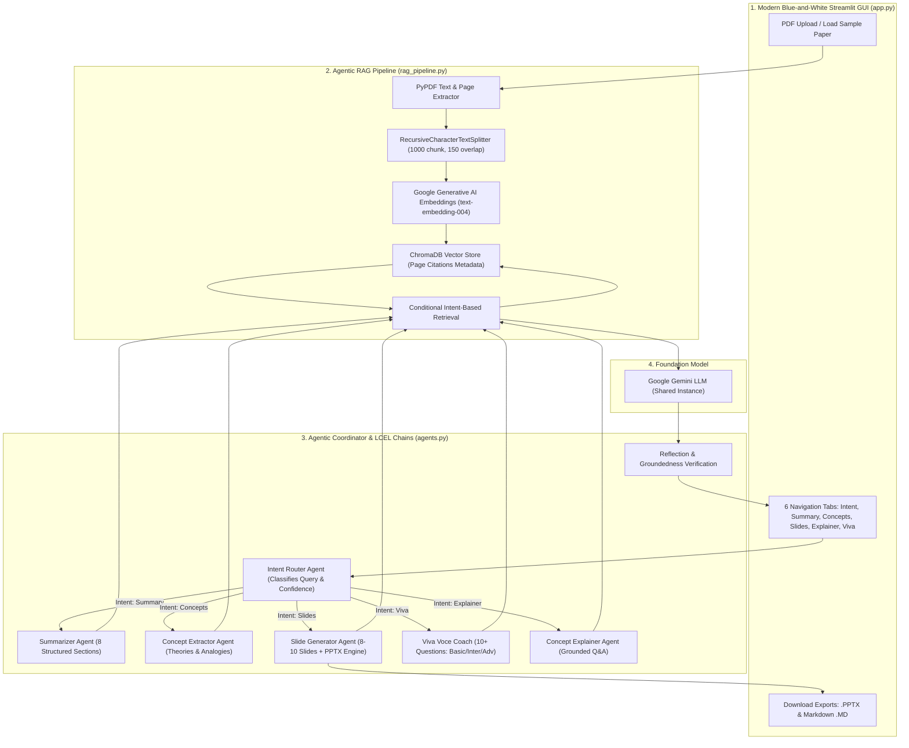

# 🎓 PaperMate AI – Research Paper to Presentation & Viva Assistant


---

## 📑 Table of Contents
1. [Project Overview](#-project-overview)
2. [7 Mandatory Acceptance Criteria Verification](#-7-mandatory-acceptance-criteria-verification)
3. [System Architecture](#-system-architecture)
4. [Key Features](#-key-features)
5. [Technology Stack](#-technology-stack)
6. [Agentic Architecture & Workflow](#-agentic-architecture--workflow)
7. [Prompt Engineering & LCEL](#-prompt-engineering--lcel)
8. [Agentic RAG & ChromaDB Implementation](#-agentic-rag--chromadb-implementation)
9. [Installation & Windows Local Setup](#-installation--windows-local-setup)
10. [Step-by-Step Testing & Verification Guide](#-step-by-step-testing--verification-guide)
11. [Project Structure](#-project-structure)

---

## 🌟 Project Overview

**PaperMate AI** is an intelligent, multi-agent academic assistant designed to bridge the gap between complex research publications and student comprehension. Reading research papers is often daunting for undergraduate and postgraduate students. PaperMate AI extracts, indexes, and synthesizes scientific papers to provide:
1. **8-Section Comprehensive Academic Summaries**
2. **Core Concept, Algorithm & Contribution Extraction with Real-World Analogies**
3. **Conference-Ready 8–10 Slide Presentations with 1-Click Editable PowerPoint (`.pptx`) Export**
4. **Interactive Concept Explainer Q&A with Strict Document Grounding**
5. **Viva Voce Defense Coach with 10+ Tiered Questions (Basic, Intermediate, Advanced) and Examiner Defense Tips**
6. **Smart Intent Router** that automatically classifies natural language queries and invokes the appropriate agent.

---

## 🎯 7 Mandatory Acceptance Criteria Verification

This project satisfies all **7 mandatory college acceptance criteria** directly in the source code and user interface:

| # | Acceptance Criterion | Source Code File & Component | Implementation Details |
|---|---|---|---|
| **1** | **LLM Integration** | `agents.py` & `model_manager.py` | Google Gemini API with dynamic model discovery, generateContent verification, and centralized configuration across all 4 agents (default: `gemini-3.8-flash`). |
| **2** | **Interactive GUI** | `app.py` (Streamlit) | Modern blue-and-white academic interface with sidebar navigation, metric cards, 6 dedicated functional tabs, file uploaders, and download buttons. |
| **3** | **Prompt Engineering** | `prompts.py` (`SYSTEM_PROMPT`, agent prompts) | Scholarly system prompt enforcing boundary integrity ("do not hallucinate"), 4 agent prompts with strict outputs, and a concise Reflection Verification prompt. |
| **4** | **LangChain & LCEL** | `agents.py` (`chain = prompt \| llm \| parser`) | Built using LangChain Expression Language (LCEL) with the pipe operator (`\|`), `ChatPromptTemplate`, and `StrOutputParser`. |
| **5** | **Agentic RAG** | `rag_pipeline.py` (`RAGPipeline`) | End-to-end RAG with PyPDF extraction, `RecursiveCharacterTextSplitter`, citation tracking, conditional retrieval, and document boundary checks. |
| **6** | **Intent Detection & Routing** | `agents.py` (`route_intent`) & `prompts.py` | LLM-based intent classifier with confidence scoring and rule-based fallback, routing requests to Summarizer, Concepts, Slides, Viva, or Explainer. |
| **7** | **ChromaDB Vector Database** | `rag_pipeline.py` (`Chroma.from_documents`) | Vector storage and similarity retrieval using Google Generative AI embeddings (`models/text-embedding-004`) with citation metadata. |

---

## 🏗️ System Architecture



---

## 🚀 Key Features

### 1. 📄 PDF Ingestion & Document Processing
- Upload research papers in PDF format.
- Uses **PyPDF** to extract text with page-by-page mapping and metadata.
- Computes metrics: total pages, word count, character count, and semantic chunks.
- **1-Click "Load Sample Paper" button**: Preloaded with the seminal paper *Attention Is All You Need* (Vaswani et al., 2017) for instantaneous evaluation without searching for a PDF file!

### 2. 📑 8-Section Comprehensive Academic Summary
Generates an exhaustive, structured summary across 8 distinct academic sections:
1. **Abstract & High-Level Overview**
2. **Introduction & Scientific Background**
3. **Problem Statement & Research Gap**
4. **Proposed Methodology & Architecture**
5. **Key Findings & Scientific Contributions**
6. **Experimental Results & Performance Benchmarks**
7. **Limitations & Open Challenges**
8. **Conclusion & Future Directions**

### 3. 💡 Deep Concept & Contribution Extractor
- Breaks down complex technical terminology into plain English.
- Accompanies every technical concept with an **intuitive real-world analogy**.
- Identifies algorithms, mathematical formulations, software libraries, datasets, and hardware used.
- Formulates the top 3–5 novel contributions distinguishing the paper from prior art.

### 4. 📊 Slide Deck Generator & Editable PowerPoint (`.pptx`) Export
- Structures 8 to 10 conference-grade presentation slides.
- Each slide contains: Title, Subtitle, 3–4 concise bullet points, and **in-depth Speaker Notes** (what the student should say aloud during the presentation).
- **Native PowerPoint Generation**: Generates a 16:9 widescreen presentation using `python-pptx` with a custom academic navy-blue palette, card borders, and speaker notes.
- Download button delivers a ready-to-present `.pptx` file directly to your downloads folder.

### 5. 💬 Concept Explainer (Ask Paper Q&A)
- Students can ask any technical question about the paper.
- Delivers a 4-step response:
  1. Direct 1-sentence TL;DR
  2. Grounded paper explanation with specific section references
  3. Beginner-friendly pedagogical analogy
  4. Explicit boundary enforcement (clearly states if a detail is not in the paper).
- Includes expandable sources showing the exact ChromaDB chunks and page numbers retrieved.

### 6. 🎓 Viva Voce Defense Coach
- Prepares students for college thesis defense or oral viva examinations.
- Generates **at least 10 likely questions** across three progressive tiers:
  - **Tier 1: Fundamental & Conceptual Questions (Basic)**: Core hypothesis, motivation, baseline definitions.
  - **Tier 2: Methodological & Architectural Questions (Intermediate)**: Design trade-offs, loss function behavior, hyperparameter selection.
  - **Tier 3: Defense & Critical Analysis Questions (Advanced)**: Computational bottlenecks, failure modes, scalability limits, and ethical/data biases.
- Every question includes the **Model Grounded Answer** and a tactical **Examiner Defense Strategy**.

### 7. 🧭 Smart Intent Router
- Accepts natural language instructions (e.g., *"Make slides for my seminar"*, *"Summarize the methodology"*, *"What questions will my professor ask?"*).
- Uses LangChain LCEL to parse the intent, calculates confidence score, and automatically calls the target agent.

### 8. 🛡️ Reflection & Verification Step
- Automatically reviews every agent output against the retrieved paper chunks.
- Displays a clean verification badge (e.g., `🛡️ Status: VERIFIED GROUNDED | Confidence: High (95%)`).
- Prevents hallucinations without cluttering the screen with internal scratchpads.

---

## 💻 Technology Stack

| Component | Library / Technology | Purpose |
|---|---|---|
| **Programming Language** | Python 3.10+ | Core language environment |
| **User Interface** | Streamlit 1.35+ | Interactive, modern blue-and-white web GUI |
| **Large Language Model** | Google Gemini API (Dynamic discovery, default: `gemini-3.8-flash`) | High-speed, high-context scientific reasoning |
| **AI Framework** | LangChain Core & LangChain Community | Chain composition and prompt orchestration |
| **Prompt Chaining** | LangChain LCEL (`\|` pipe operator) | Declarative chain compilation |
| **Vector Storage** | ChromaDB (`chromadb` / `langchain-chroma`) | Vector database for similarity retrieval |
| **Embeddings** | Google Generative AI Embeddings (`text-embedding-004`) | High-dimensional semantic embeddings |
| **PDF Extraction** | PyPDF 4.2+ | Text, page citation, and metadata extraction |
| **Presentation Generation**| Python-PPTX 0.6+ | Native Microsoft PowerPoint (.pptx) file creation |
| **Environment Management** | Python-Dotenv | Secure API key configuration |

---

## 🤖 Agentic Architecture & Workflow

PaperMate AI uses a **single shared Gemini model instance** parameterized with distinct specialized prompt templates to form four logical agents, an Intent Router, and a Reflection Inspector:

```
User Query / Task
       │
       ▼
┌─────────────────────────┐
│   Intent Router Agent   │ ──► [Classifies: Summary | Concepts | Slides | Viva | Explainer]
└─────────────────────────┘
       │
       ├────────────────────────────────────────┬────────────────────────────────────────┐
       ▼                                        ▼                                        ▼
┌─────────────────────────┐          ┌─────────────────────────┐          ┌─────────────────────────┐
│    Summarizer Agent     │          │ Concept Extractor Agent │          │  Slide Generator Agent  │
│ (8 Academic Dimensions) │          │  (Analogies & Pillars)  │          │ (8-10 Slides + .PPTX)   │
└─────────────────────────┘          └─────────────────────────┘          └─────────────────────────┘
       │                                        │                                        │
       └────────────────────────────────────────┴────────────────────────────────────────┘
                                                │
                                                ▼
                               ┌─────────────────────────────────┐
                               │       Conditional Retrieval     │ ──► Queries ChromaDB based on intent
                               └─────────────────────────────────┘
                                                │
                                                ▼
                               ┌─────────────────────────────────┐
                               │  Reflection & Verification Step │ ──► Validates groundedness
                               └─────────────────────────────────┘
                                                │
                                                ▼
                               ┌─────────────────────────────────┐
                               │     Streamlit Interactive UI    │ ──► Display & Downloads
                               └─────────────────────────────────┘
```

---

## ✍️ Prompt Engineering & LCEL

All prompts are declared in `prompts.py` using `ChatPromptTemplate` and `PromptTemplate`:

### 1. System Prompt
Enforces academic rigor, beginner clarity, and strict boundary integrity:
```python
SYSTEM_PROMPT = """You are PaperMate AI, an elite academic research assistant and viva defense coach.
CORE OPERATIONAL RULES:
1. GROUNDEDNESS: Rely strictly on the provided research paper context. Never invent findings...
2. BOUNDARY INTEGRITY: If the retrieved context does not contain enough information, state:
   'Based on the provided research paper, this specific detail is not mentioned or cannot be verified.'
3. ACADEMIC RIGOR & CLARITY: Maintain scholarly precision with pedagogical clarity...
"""
```

### 2. LCEL Chain Compilation
All agents compile declaratively using the LCEL pipe operator (`|`):
```python
# LCEL Chain Definition in agents.py
self.output_parser = StrOutputParser()

# Intent Router Chain
self.intent_chain = INTENT_ROUTER_PROMPT | self.llm | self.output_parser

# Summarizer Chain
self.summarizer_chain = SUMMARIZER_PROMPT | self.llm | self.output_parser

# Concept Extractor Chain
self.concept_chain = CONCEPT_EXTRACTOR_PROMPT | self.llm | self.output_parser

# Slide Generator Chain
self.slide_chain = SLIDE_GENERATOR_PROMPT | self.llm | self.output_parser

# Viva Agent Chain
self.viva_chain = VIVA_AGENT_PROMPT | self.llm | self.output_parser

# Reflection Verification Chain
self.reflection_chain = REFLECTION_VERIFICATION_PROMPT | self.llm | self.output_parser
```

---

## 🔍 Agentic RAG & ChromaDB Implementation

### 1. Document Extraction & Chunking
- `PyPDF` iterates over pages, strips whitespace, and maintains page index metadata.
- `RecursiveCharacterTextSplitter` segments text into chunks of 1000 characters with 150 character overlap.
- Every chunk is tagged with `{"source": filename, "page": page_num, "chunk_id": idx}`.

### 2. Embedding & ChromaDB Indexing
- Embeddings are generated using Google's `models/text-embedding-004`.
- Indexed in ChromaDB:
  ```python
  self.vector_store = Chroma.from_documents(
      documents=chunks,
      embedding=self.embeddings,
      collection_name=collection_name
  )
  ```
- Includes an automatic zero-crash fallback vector store for Windows environments where binary SQLite extensions are constrained.

### 3. Conditional Retrieval
Instead of generic keyword matching, the retrieval query is conditionally adapted based on the active agent intent:
- **Summary**: Queries for abstract, introduction, problem statement, methodology, findings, results, limitations, and conclusion.
- **Concepts**: Queries for theoretical concepts, algorithms, mathematical formulations, datasets, and contributions.
- **Slides**: Queries for overview, motivation, architecture, benchmarks, and key takeaways.
- **Viva**: Queries for methodology, assumptions, baseline comparisons, ablation experiments, failure modes, and defense.
- **Explainer**: Queries specifically with the student's question augmented with definition keywords.

---

## ⚙️ Installation & Windows Local Setup

Follow these simple steps to run PaperMate AI locally on Windows:

### Step 1: Open Terminal / Command Prompt
Open PowerShell or Command Prompt and navigate to the project directory:
```powershell
cd "c:\Users\rajpr\OneDrive\Desktop\PaperMate AI – Research Paper to Presentation & Viva Assistant"
```

### Step 2: Create and Activate a Virtual Environment
```powershell
python -m venv venv
.\venv\Scripts\activate
```

### Step 3: Install Required Dependencies
```powershell
pip install -r requirements.txt
```

### Step 4: Configure your Google Gemini API Key
Create a `.env` file from `.env.example` or set it in your environment:
```powershell
copy .env.example .env
```
Open `.env` in any editor and add your key:
```env
GOOGLE_API_KEY=AIzaSyYourActualGeminiKeyHere
```
*(Alternatively, you can enter the API key directly in the Streamlit web sidebar at runtime).*

### Step 5: Run the Verification Test Suite
Run the offline verification suite to verify all modules, prompt formatting, and `.pptx` generation:
```powershell
python test_pipeline.py
```
*(Or double-click `test_app.bat` on Windows!)*

### Step 6: Launch the Streamlit Application
```powershell
streamlit run app.py
```
*(Or double-click `run_app.bat` on Windows!)*

The application will open automatically in your default browser at:
`http://localhost:8501`

---

## 🧪 Step-by-Step Testing & Verification Guide

Follow this guide to demonstrate all 7 acceptance criteria to an academic evaluator:

### Test 1: Testing LLM Integration & GUI (Criteria 1 & 2)
1. Launch `streamlit run app.py`.
2. Notice the modern blue-and-white theme, hero banner, metric cards, and sidebar.
3. Enter your Gemini API key or confirm that it loaded from `.env`.
4. The system validates the key and shows the status indicator.

### Test 2: Testing Document Ingestion & ChromaDB RAG (Criteria 5 & 7)
1. In the sidebar, click the **"📚 Load Sample"** button (or upload your own PDF).
2. The progress spinner will extract text, chunk it, embed it using Google Generative AI embeddings, and index it into ChromaDB.
3. Observe the metric counters update: Total Pages (5), Word Count (3,400+), ChromaDB Chunks (15+), and Status: Active.

### Test 3: Testing Intent Detection & Routing (Criterion 6)
1. Navigate to the **"🧭 Smart Intent Assistant"** tab.
2. Type: *"Create a 10-slide presentation for my seminar"* and click **"🔍 Route & Execute"**.
3. Observe the blue notification card:
   - `🎯 INTENT DETECTED: SLIDES AGENT (Confidence: 98.0%)`
   - Notice that the router automatically invoked the Slide Generator Agent!
4. Try typing: *"What questions will the external examiner ask in viva?"*
   - Observe detection: `🎯 INTENT DETECTED: VIVA AGENT (Confidence: 99.0%)`.

### Test 4: Testing 8-Section Structured Summary (Criterion 3)
1. Navigate to the **"📑 Paper Summary"** tab.
2. Click **"🚀 Generate 8-Section Structured Summary"**.
3. Verify that all 8 sections are generated with headers (Abstract, Introduction, Problem Statement, Methodology, Key Findings, Results, Limitations, Conclusion).
4. Verify the **Reflection Verification box** at the top (`🛡️ REFLECTION VERIFICATION: VERIFIED GROUNDED`).
5. Click **"📥 Download Summary (.md)"** to save the markdown file.

### Test 5: Testing Concept Extractor with Analogies (Criterion 3)
1. Open the **"💡 Concept Extractor"** tab.
2. Click **"🔬 Extract Concepts & Methodologies"**.
3. Inspect the theoretical concepts, algorithms, frameworks, and contributions.
4. Note the real-world pedagogical analogies accompanying each technical concept.

### Test 6: Testing Slide Generator & PowerPoint Download (Criterion 4)
1. Open the **"📊 Slide Deck & PPTX"** tab.
2. Click **"📽️ Generate Slide Deck & PowerPoint (.pptx)"**.
3. Review the 8–10 structured slides on screen, including the **Speaker Notes** box for each slide.
4. Click the large blue **"📥 Download Presentation (.pptx)"** button.
5. Open the downloaded `.pptx` file in Microsoft PowerPoint or Google Slides to verify:
   - 16:9 widescreen layout.
   - Clean academic navy-blue color theme.
   - Slide titles, subtitles, formatted bullet points, and speaker notes.

### Test 7: Testing Concept Explainer & Grounding Boundary Check (Criteria 4 & 5)
1. Open the **"💬 Concept Explainer (Ask Paper)"** tab.
2. Ask a paper-grounded question: *"How does Multi-Head Attention work?"*
   - Observe the 4-part answer (TL;DR, paper deep dive, analogy, and boundary check).
   - Expand the **"📚 View Retrieved Citations"** section to see the exact page chunks from ChromaDB.
3. Ask an unmentioned question: *"What is the recipe for chocolate cake?"* or *"How to train a quantum computing GAN?"*
   - Observe the boundary enforcement:
     `"Based on the provided research paper, this specific detail is not discussed or verified."`

### Test 8: Testing Viva Voce Coach (Criterion 6)
1. Open the **"🎓 Viva Voce Coach"** tab.
2. Click **"🛡️ Generate 10+ Viva Questions & Defense Guide"**.
3. Inspect the 10–12 questions split across **Basic, Intermediate, and Advanced** tiers.
4. Review the model answers and the tactical **Examiner Defense Strategy** tips.
5. Click **"📥 Download Viva Defense Guide (.md)"** to save the guide.

---

## 📁 Project Structure

```text
PaperMate AI – Research Paper to Presentation & Viva Assistant/
│
├── app.py                  # Streamlit interactive GUI with lavender glassmorphism theme
├── agents.py               # 4 specialized agents, Intent Router, Reflection & PPTX generator
├── model_manager.py        # Dynamic Gemini model discovery, connection testing & configuration
├── rag_pipeline.py         # PyPDF extraction, chunking, embeddings & ChromaDB retrieval
├── prompts.py              # System prompts, agent prompts, and verification templates
├── test_pipeline.py        # Offline test suite verifying modules, prompts, models and PPTX engine
│
├── requirements.txt        # Python package dependencies
├── .env.example            # Environment variable template for Gemini API key
├── run_app.bat             # Windows 1-click batch launcher for Streamlit app
├── test_app.bat            # Windows 1-click batch launcher for verification test suite
└── README.md               # Complete project documentation and submission report
```


## AUTHOR
## Priyanshi Raj
